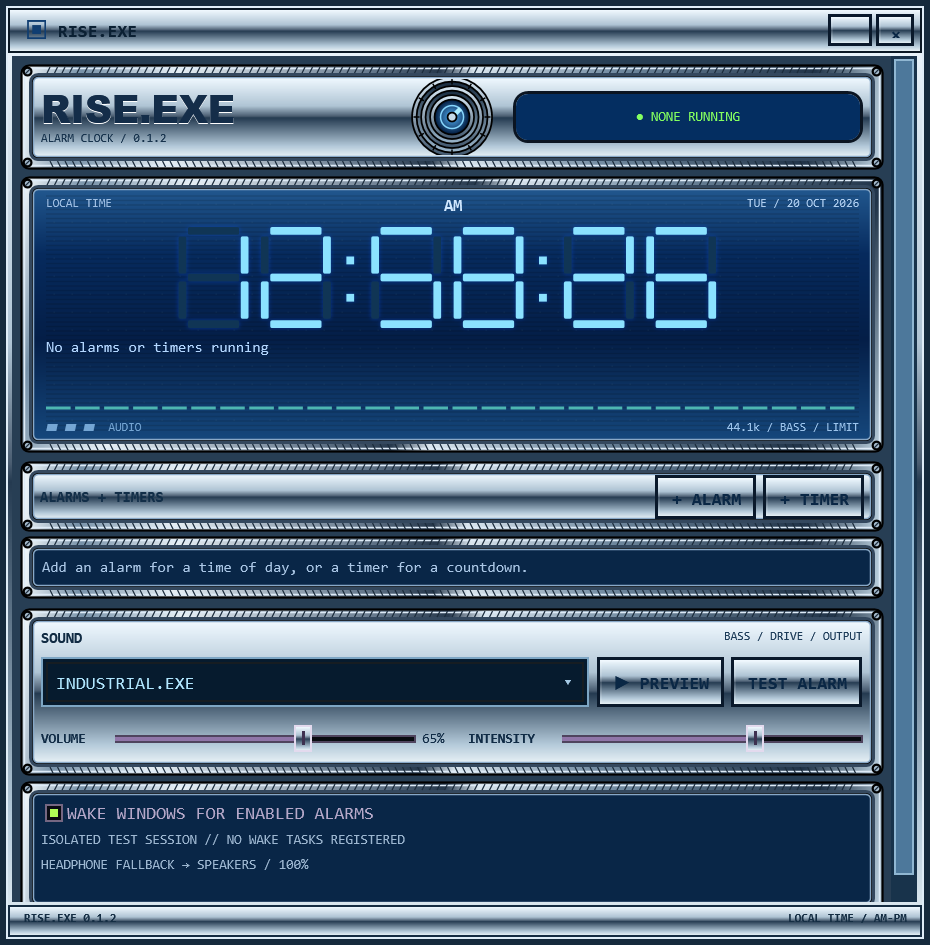

# RISE.EXE

An aggressively Y2K alarm clock that refuses to close until you wake up.

A compact Windows alarm clock and countdown timer with a blue-and-chrome WPF interface, an AM/PM segmented display, and an audio-driven spectrum monitor. Original artwork and procedural compositions; no sampled recordings.



## Download and run

Download **RISE-Setup.exe** from this repository's **Releases** page. Setup installs for your Windows user under `%LOCALAPPDATA%\Programs\RISE`, creates **desktop and Start menu shortcuts**, and adds RISE.EXE to **Settings → Apps → Installed apps**. No administrator access is needed. Launch RISE when setup finishes to refresh wake tasks to the installed path. Close RISE before upgrading or uninstalling; finish an active alarm's puzzle first. Uninstall removes shortcuts, program files, and RISE wake tasks while preserving saved alarms in `%LOCALAPPDATA%\RISE`.

**RISE.exe** and **RISE-win-x64.zip** remain available for portable use. The **Windows build** Actions workflow also provides executable and installer artifacts with licenses and checksums.

Requires Windows 10 22H2 or Windows 11, x64, a logged-in Windows user, and an enabled audio output device. No .NET installation or administrator rights are normally required. The executable is self-contained and unsigned. Keep it in a permanent location: wake tasks reference its full path. Moving it requires reopening RISE to refresh the tasks.

## Use it

- **+ ALARM** opens a focused editor: choose hour, minute, and **AM or PM**. One-time alarms default to the next occurrence, automatically choosing today or tomorrow. Repeat presets include every day, weekdays, weekends, and custom days. Choose a specific date only when needed.
- **+ TIMER** starts a countdown using hours, minutes, and seconds, with 5-, 15-, and 30-minute presets. Timers show a live countdown; **Pause** preserves the remaining time and **Start** resumes it. Starting a finished timer repeats its original duration. **EDIT** changes an existing timer and restarts it with the new duration.
- Every alarm and timer has its own sound, **EDIT** button, and delete button. **On/Off** enables or disables alarms. Edits update the existing entry rather than adding duplicates. Changes save automatically to `%LOCALAPPDATA%\RISE\settings.json`, with an atomic replacement and backup. Running and paused timers survive restarts; timers keep an absolute deadline across time-zone changes and attempt to wake Windows when wake tasks are enabled.
- **PREVIEW** auditions a sound for up to ten seconds; click **STOP** to stop it. **TEST ALARM** runs the full puzzle and closing behavior.
- **VOLUME** normally changes this app's output (5–100%). **INTENSITY** changes saturation and timbre, with a digital peak ceiling of 0.94 before volume. Every preset has a separate sub-bass/kick bus around 40–80 Hz. Headphone haptic response depends on the device, its bass setting, and Windows output level.
- **Headphone fallback:** during an alarm or expired timer (including **TEST ALARM**), disconnecting headphones, muting them, setting their Windows volume to zero, or muting RISE's headphone mixer session routes the alarm to an enabled **speaker** endpoint. Speaker Windows volume and RISE's own speaker volume are set to **100%, unmuted** and enforced until dismissal. Reconnecting headphones does not undo the fallback. The previous speaker volume/mute setting is restored after the puzzle or an orderly exit; force termination cannot perform restoration. Speaker master volume also affects other apps using those speakers. Previews and idle schedules never enforce volume. RISE uses the Windows default speaker endpoint if available, otherwise prefers a Realtek/internal speaker endpoint; it does not change the global default output. Missing speakers produce an error and are retried. Headphones are identified by Windows form factor and common headphone/headset names. A physical dial or power switch that reports no change to Windows cannot be detected. Combined headphone/speaker endpoints that Windows exposes as one device cannot be distinguished reliably.
- A ringing alarm or finished timer shows **one five-tile sequence**. Watch, then repeat it using the mouse, **1–4**, numpad **1–4**, or **Q W E R**. Each tile has its own loud, bright bell note (C5, E5, G5, C6), played during the demonstration and on your input. The alarm briefly ducks beneath each note so the melody stays clear. Color, position, and number also identify each tile. Mistakes and **REPLAY SEQUENCE** start a fresh five-tile sequence. Finishing that one sequence dismisses the alarm immediately; only the final note's short tail continues.
- While ringing, X, Alt+F4, and ordinary taskbar Close are rejected through WPF `Window.Closing`. Each attempt resets the puzzle and activates a ridiculous synthesized brass/kazoo fanfare. It changes the arrangement without escalating the amplitude ceiling. Complete the puzzle to stop playback immediately and restore normal closing.
- Simultaneous alarms share one output stream and one verification session. Completion acknowledges all alarms that have already joined that session. An unacknowledged session, including escape count, resumes after relaunch.

Task Manager, Windows shutdown, sign-out, and other OS controls remain available. There is no watchdog or automatic relaunch following force termination. A future alarm's explicitly registered scheduled task can still launch the app.

See the [alarm editor](docs/screenshots/alarm-editor.png) and [timer editor](docs/screenshots/timer-editor.png).

## Sleep and wake

Leave **WAKE WINDOWS FOR ENABLED ALARMS** checked. RISE registers per-user Task Scheduler tasks with `WakeToRun=true`, `StartWhenAvailable=true`, and interactive-user execution. It coordinates launches with an existing instance using a per-user mutex and restricted named pipe. Removing or disabling alarms removes their tasks; turning wake off removes all RISE alarm tasks. The diagnostic line reports registration failure. Normal closing leaves enabled tasks in place so alarms can launch RISE later.

Windows must permit wake timers, the hardware/firmware must support the current sleep state, and the user must remain signed in. Battery policy, Modern Standby, hibernation, lid settings, audio routing, or a muted Windows session can prevent wake or audible playback. RISE cannot power on a shut-down computer or play before Windows wakes. Test a near-future alarm on your own hardware before relying on overnight wake. During ringing, it requests system/display wakefulness without blocking shutdown.

Schedules follow the computer's local wall time. A spring-forward nonexistent minute resolves to the first valid minute; a fall-back repeated minute rings once at its first occurrence. Missed alarms are recovered within **24 hours**; older one-time alarms expire, and recurring alarms recover only the latest eligible occurrence. New or re-enabled alarms do not retroactively ring for times before they were armed. Pending unacknowledged sessions have no expiry. Launch RISE after changing the computer's time zone or moving the executable to refresh wake tasks.

**Hardware sleep/resume and speaker loudness remain hardware-dependent validation items.** See [verification](docs/VERIFICATION.md) for the tested scope and [design notes](docs/DESIGN.md) for research references.

## Build and test

On Windows with the .NET 10 SDK:

```powershell
dotnet restore RISE.slnx
dotnet build RISE.slnx -c Release --no-restore
dotnet run --project tests/Rise.Tests -c Release --no-build
dotnet publish src/Rise.App -c Release -r win-x64 --self-contained true `
  -p:PublishSingleFile=true -p:IncludeNativeLibrariesForSelfExtract=true `
  -p:EnableCompressionInSingleFile=true -p:DebugType=None -p:DebugSymbols=false `
  -o artifacts/publish
$p = Start-Process artifacts/publish/RISE.exe -ArgumentList '--self-test' -PassThru -Wait
if ($p.ExitCode -ne 0) { throw 'WPF integration tests failed' }
```

Run `./scripts/build.ps1` for the app, then `./scripts/package.ps1` and `./scripts/test-installer.ps1` for the Windows installer and shortcut/uninstall checks. Core tests use a dependency-free console runner with a nonzero failure exit code. The WPF self-test creates an isolated settings directory and a temporary scheduled-task folder, checks real COM registration and cleanup, exercises close cancellation and dismissal, streams each composition past its loop boundary, and writes rendered screenshots/results under `artifacts/smoke`. It suppresses audible hardware playback; native output initialization is checked with a zero-sample stream when available. It does not simulate physical sleep or assert audible output.

For an isolated interactive session without registering wake tasks:

```powershell
artifacts/publish/RISE.exe --data-dir C:\path\to\disposable-test-data
```

`--wake <alarm-id>` is used by Task Scheduler. All eligible alarms are reconciled on launch; arbitrary/stale wake arguments cannot force an alarm early. Keep the single-file executable and redistribution notices together when redistributing packages. Notices are also embedded in the executable.

The Windows workflow runs on main-branch pushes and manual dispatch, uses official GitHub Actions, checks every command's exit code, uploads the Windows executable and test evidence, and publishes `v<project version>` only after tests pass. Existing releases are preserved; bump the project version to publish a new one.

## Project

- `src/Rise.Core`: scheduling, state transitions, puzzle, atomic JSON store, deterministic synthesis.
- `src/Rise.App`: WPF interface, NAudio output, Windows wake tasks, single-instance coordination, integration tests.
- `tests/Rise.Tests`: scheduling/DST, state recovery, puzzle, persistence, and audio-composition checks.

## License

Original RISE code, compositions, and artwork: **Unlicense**; see [LICENSE](LICENSE). Dependencies retain their licenses. NAudio 2.2.1 uses MIT; the bundled .NET runtime uses MIT and its included third-party notices. See [THIRD_PARTY_NOTICES.md](THIRD_PARTY_NOTICES.md) and `licenses/`.
